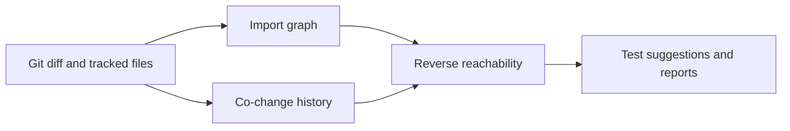

<p align="center"></p>
<h1 align="center">diffblast</h1>
<p align="center"><strong>Estimate change impact before choosing which tests to run.</strong></p>

[](https://github.com/LucasYanzy/diffblast/actions/workflows/ci.yml) [](LICENSE) [](https://github.com/LucasYanzy/diffblast/blob/main/pyproject.toml)  [](https://github.com/LucasYanzy/diffblast/stargazers)

[English](README.md) · [简体中文](README.zh-CN.md)


The demo is captured from the real CLI using synthetic data. [Transcript](demo/terminal.txt) · regenerate with `python3 scripts/demo.py`.

## Why

A small edit can affect files you never opened. diffblast combines local import relationships and Git co-change history to suggest where to look next.

| Start with | Good for | Where diffblast helps |
|---|---|---|
| `git diff` | See changed lines | diffblast also estimates related files and tests. |
| Full test suite | Validate behavior | diffblast suggests review targets; it does not execute tests. |

## Quick start

```bash
git clone https://github.com/LucasYanzy/diffblast.git && cd diffblast
python3 -m pip install .
python3 scripts/demo.py
```

Install from this checkout to use the reviewed source version. The installed tool has no third-party runtime dependencies; cloning and installation can require network access.

## Features

### Trace imports

Extract imports and includes from tracked files, then follow reverse dependency edges. Resolution is heuristic, not a compiler.

### Use change history

Include files that repeatedly changed together. Disable this signal with `--no-cochange`.

### Suggest tests

List impacted test files and source/test filename matches. Recommendations do not prove that other tests are safe to skip.

### Export results

Print a terminal report, emit JSON, or write Markdown for review.


## Usage

```bash
diffblast --path /path/to/project --base main
diffblast --json
diffblast --md --out report.md
diffblast --no-cochange
```

## Architecture



## Privacy and limits

Reads the selected local repository and Git history. It makes no application network calls. Exported reports contain repository file paths; review them before sharing. See [PRIVACY.md](PRIVACY.md) for data boundaries.

## Development

```bash
python3 -m pip install -e ".[test]"
python3 -m pytest -q
```

The demo uses a temporary fixture and does not inspect your personal repositories or agent homes.

## Roadmap

- [ ] Improve import resolution across ecosystems.
- [ ] Add documented CI recipes and structured output formats.

## Contributing

Read [CONTRIBUTING.md](CONTRIBUTING.md). Report reproducible problems in [Issues](https://github.com/LucasYanzy/diffblast/issues). Follow [SECURITY.md](SECURITY.md) for sensitive reports.

## License

[MIT](LICENSE).
