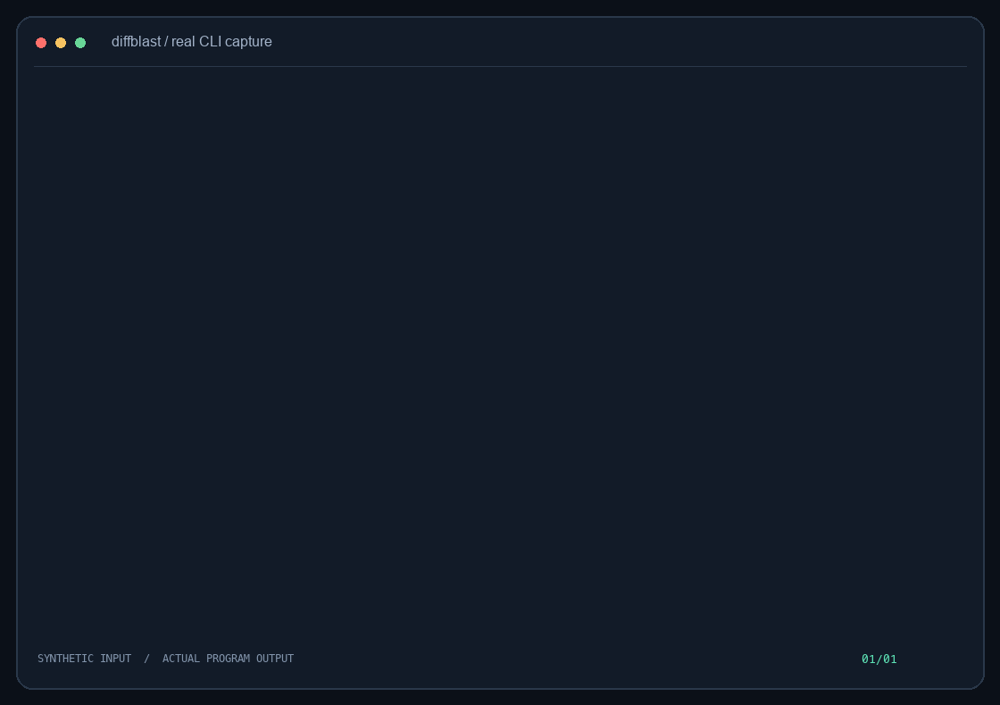
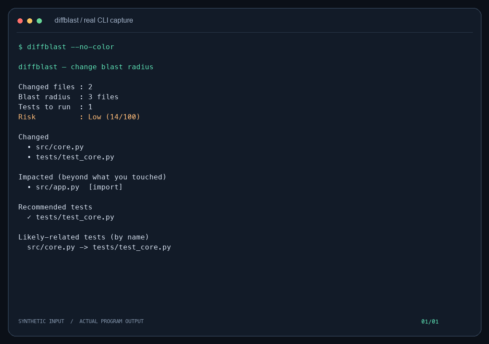
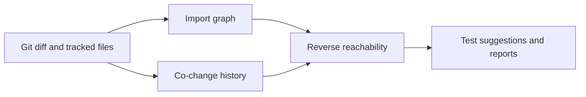

<p align="center"></p>
<h1 align="center">diffblast</h1>
<p align="center"><strong>修改代码后，先估计影响范围，再决定检查哪些测试。</strong></p>

[](https://github.com/LucasYanzy/diffblast/actions/workflows/ci.yml) [](LICENSE) [](https://github.com/LucasYanzy/diffblast/blob/main/pyproject.toml)  [](https://github.com/LucasYanzy/diffblast/stargazers)

[English](README.md) · [简体中文](README.zh-CN.md)



演示来自真实程序输出，输入全部为合成数据。[终端记录](demo/terminal.txt)；运行 `python3 scripts/demo.py` 可复现。

## 为什么需要它

一处小改动可能影响从未打开过的文件。diffblast 将本地导入关系与 Git 中共同修改的记录结合起来，给出下一步值得检查的文件和测试。

## 快速开始

```bash
git clone https://github.com/LucasYanzy/diffblast.git && cd diffblast
python3 -m pip install .
python3 scripts/demo.py
```

从当前检出目录安装即可运行已审阅的源码版本。安装后的工具无第三方运行依赖；克隆与安装过程仍可能需要联网。

## 功能

### 导入关系

从已跟踪文件提取导入与 include 语句，再沿反向依赖传播。解析基于启发式规则，并不等同于编译器。

### 共同修改记录

将历史上经常共同修改的文件作为弱关联；可用 `--no-cochange` 关闭。

### 建议测试

找出受影响的测试与按文件名配对的测试，不保证其余测试可以跳过。

### 导出结果

提供终端、JSON 与 Markdown 输出，便于检查或接入 CI。



## 使用

```bash
diffblast --path /path/to/project --base main
diffblast --json
diffblast --md --out report.md
diffblast --no-cochange
```

## 架构



## 隐私与边界

读取选定的本地仓库与 Git 历史，程序不发起网络请求。导出的报告包含仓库内文件路径，分享前需检查内容。 详见 [PRIVACY.md](PRIVACY.md)。

## 开发与验证

```bash
python3 -m pip install -e ".[test]"
python3 -m pytest -q
```

演示只使用临时样例，不会扫描你的个人仓库或代理主目录。

## 路线图

请参阅[英文路线图](README.md#roadmap)，其中只列出尚未实现的工作。

## 贡献与许可

贡献方式见 [CONTRIBUTING.md](CONTRIBUTING.md)，安全问题见 [SECURITY.md](SECURITY.md)。采用 [MIT License](LICENSE)。
